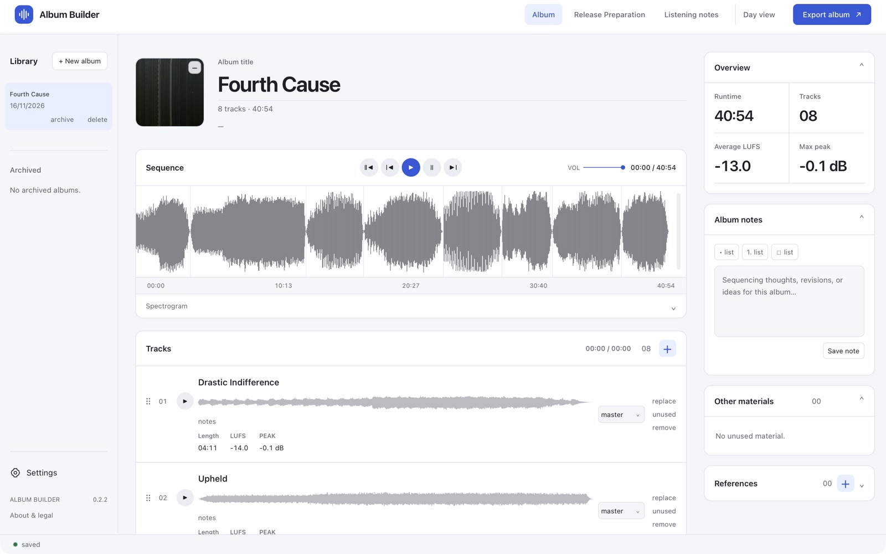
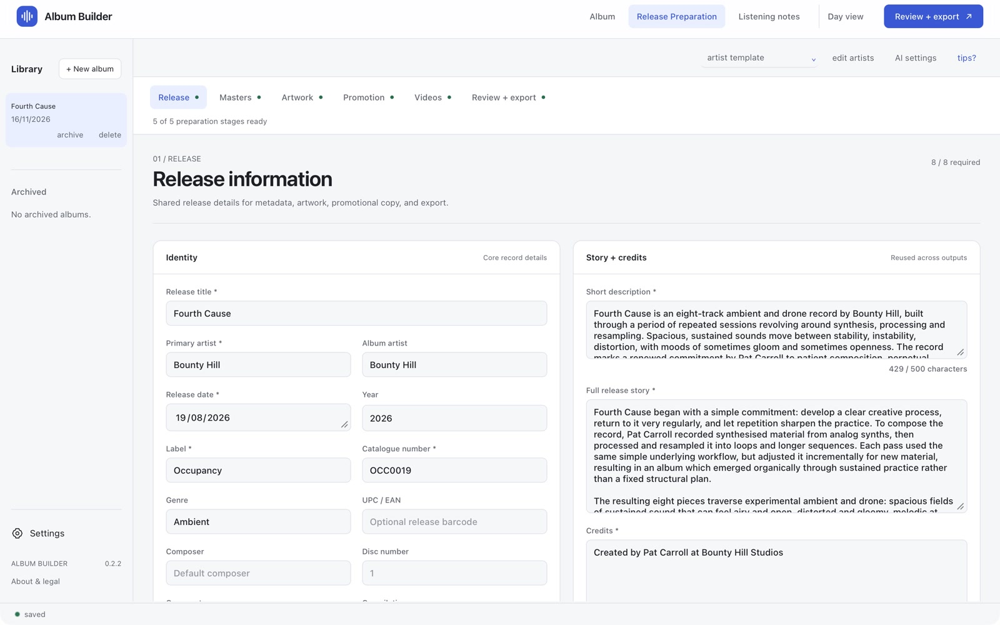

# Album Builder

Album Builder gives an album or EP somewhere to take shape. I made it because I wanted to keep the running order, different versions of songs, listening notes and release details together as a record moves from sketches and demos towards finished masters.

There are two connected stages. **Album** is the listening and sequencing workspace. **Release Preparation** carries the same record into master metadata, artwork, promotional copy, videos and a delivery package. The source audio stays unchanged.



*Fourth Cause by Bounty Hill, with all eight WAV masters loaded.*

This is a macOS development project, built with HTML, CSS, JavaScript and Tauri/Rust. The public repository contains source and build instructions, not a downloadable installer. The application remains copyrighted under the existing [Terms of Use](TERMS.md); making the source public does not grant an open-source licence.

For the implementation guide, see [Project Overview.md](Project%20Overview.md).

## Current development version

The current version is **0.2.2**. Album Builder now contains two stages: **Album** for composing a sequence and **Release Preparation** for preparing masters, release information, artwork, promotional copy, videos, Canvas loops and delivery packages. The second stage incorporates Release Preparer 0.1.29, using the same album record and modern Day/Night interface. The earlier Release Copy and Release Metadata forms have been consolidated into that stage.

Local development bundles can be kept in `releases/Album Builder 0.2.2.app`. That ignored folder is not distributed here. The locally tested bundle is ad-hoc signed and is not an Apple-notarised public release. Changes are recorded in [CHANGELOG.md](CHANGELOG.md).

## Installation

This version has been built and tested on an Apple Silicon Mac. Windows and Linux packages have not been verified; the preparation workflow includes macOS-specific Keychain and Finder operations.

You will need Git, a current Node.js/npm installation (Node 22 or newer), current stable Rust, and Apple's Xcode Command Line Tools. Follow the [Tauri prerequisites](https://v2.tauri.app/start/prerequisites/) for the native build environment. Install [FFmpeg and ffprobe](https://ffmpeg.org/download.html) separately for tagged audio and video/Canvas exports; on a Mac with Homebrew, `brew install ffmpeg` provides both.

```sh
git clone https://github.com/pmancaz/album-builder.git
cd album-builder
npm ci
npm run tauri:dev
```

For a local application bundle:

```sh
npm run tauri:build -- --bundles app
```

The result is `src-tauri/target/release/bundle/macos/Album Builder.app`. No audio files, local library, model weights or credentials are included in the repository. Optional AI drafting needs your own OpenAI API key and a model available to that account; the ordinary album and export workflow does not require AI.

`npm run dev` starts a browser preview and `npm run build` creates the web bundle. The browser preview does not provide durable desktop audio restoration or native exports. Use the Tauri app for saved albums.

On this development Mac, `DEVELOPER_DIR=/Library/Developer/CommandLineTools` selects the installed command-line toolchain if the selected Xcode installation prevents building. Other Macs should use their own configured toolchain.

## First album

1. Give the album a working title and add audio with **+** or a file drop.
2. Try a running order, mark tracks as sketches/demos/masters, and keep notes beside the audio. References and other materials stay separate from the sequence.
3. Open the optional spectrogram when useful. The first pass creates analysis; future openings reuse it unless the audio changes.
4. Use **Release Preparation** to enter shared release facts and work on the masters, artwork and copy. Review the checklist and choose an export folder when ready.
5. Use **Settings** to choose the album-library folder. Keep the referenced audio available at its saved location.

The three-lane Transition Layout previews overlaps and fades non-destructively. Export Album produces the ordinary ordered track copies; it does **not** render those overlaps into a newly mastered album file.

## Verification

For browser regressions, install Playwright as a development-only tool (`npm install --no-save --package-lock=false playwright`) and set `CHROMIUM_EXECUTABLE` to a local Chrome executable, or provide the browser runtime used by your test environment. It is not needed to run the app.


- `npm test` runs the project-format and spectrogram unit tests.
- `DEVELOPER_DIR=/Library/Developer/CommandLineTools cargo test --manifest-path src-tauri/Cargo.toml --lib` runs the native storage/export tests on this Mac. For a local audit that must not write credentials, append `-- --skip macos_keychain_backend_persists_across_entries`. The format test uses local FFmpeg and ffprobe when available.
- With `npm run dev` running, `npm run test:browser` runs synthetic project-lifecycle, audio, UI, preparation-race and prototype-licensing regressions. Set `PLAYWRIGHT_MODULE` to an available Playwright `index.mjs` (or install Playwright in your development environment). `CHROMIUM_EXECUTABLE` and `CHROME_PATH` can select a local Chrome executable. The tests use disposable browser storage and generated audio, never personal albums.
- `npm run test:production` builds and serves the actual production files, then checks MP3/WAV analysis and the optional spectrogram. This catches worker-packaging failures that the development server can hide. Use the same Playwright/browser environment variables as above.
- UI tests can also use `TEST_BROWSER=webkit` and `WEBKIT_EXECUTABLE` for a local WebKit test runtime. This approximates the renderer but does not prove packaged desktop or physical listening behavior.

Open **Settings** at the bottom of the library sidebar to view the current library location or choose another folder. Changing folders first saves the open album, then copies saved album JSON files and recovery copies, verifies them and switches future saves to that folder. Original files remain in the previous folder; different files with the same name are never overwritten. **Use default folder** copies the library back using the same checks. The chosen location is remembered on this Mac in `settings.json` beside the licence, which stays local and is never included in a library copy. If a custom drive is disconnected, saving/loading reports the unavailable library rather than creating an empty replacement. Reconnect it before moving the library.

The library references source audio; it does not contain audio copies. A synced folder can carry the album records between computers, but source paths must still resolve on each Mac. Avoid editing the same album on both Macs simultaneously and let syncing finish before opening it elsewhere.

Saved desktop albums use atomic JSON writes with a `.bak` recovery copy. An unreadable source blocks loading before the current album is replaced. Restore the named file to its saved location and retry. The browser preview cannot restore source audio across reloads; use the desktop app for durable audio projects.

Exports create a new album folder (adding a number when the name already exists). WAV audio remains unchanged; raw AAC uses the text companion for metadata; Ogg/Opus use a separate cover file. Failed files are listed in the copyable error report.

## Prototype and commercial builds

The default build is a licence-free prototype. It does not prompt for a key, read stored licence credentials, or contact Lemon Squeezy. Saving, audio work and all release-preparation exports are available offline without activation. Existing licence files are left untouched.

A future commercial build can explicitly opt in with `npm run tauri:build -- --features licensed-release` (or `cargo build --features licensed-release`).

Album Builder uses Lemon Squeezy's Licence API directly from the packaged Tauri app; it does not require a separate licensing server or a secret API key in the app. Its live Album Builder store, product, and variant IDs are configured in `src-tauri/src/lib.rs`. In Lemon Squeezy, make sure licence-key generation is enabled for that variant, the activation limit is two, and the licence length is perpetual. A customer enters their key and checkout email once per Mac. Later checks reuse the saved activation automatically; the key is requested again only for a new/reset Mac or if Lemon Squeezy reports that the saved licence is no longer valid.

## Legal

- [Privacy Policy](PRIVACY.md)
- [Terms of Use](TERMS.md)
- Support: [info@pcarroll.au](mailto:info@pcarroll.au)

© 2026 Pat Carroll. All rights reserved.

## Release Preparation



*Enter the release facts once, then reuse them across the prepared outputs.*


Open **Release Preparation** in the toolbar. Its Release, Masters, Artwork, Promotion, Videos and Review + export sections retain the standalone preparation workflow. The current album sequence supplies the initial master cards, release title and artwork. Shared artist/date/story/credits/link values are entered here once and saved with the album. Album titles and linked master titles/order stay connected to the sequencing stage. Source tracks remain unchanged when prepared exports are created. Removed preparation master cards remain excluded on reopening; **Use album sequence** repopulates them.

Artist, artwork and video templates remain reusable. Older Album Builder link presets are made available as artist templates. Optional AI drafting retains the macOS Keychain API-key setting; no API key is written into an album. AI requests run only when explicitly requested in the interface.

Use **Settings → Import Release Preparer project…** to copy an existing standalone JSON project into a new album. The source JSON and its previous export package are preserved. Select a new export location for the imported album when ready. The standalone app and its source folder remain intact.

Albums saved by 0.2.0 use schema version 2 so older Album Builder versions refuse to open them instead of dropping preparation data. Version-1 albums remain supported and migrate on save. The preparation stage uses the same configurable library folder as the Album stage.

Both HTML entry points are packaged by Vite. The preparation view has isolated presentation, while its native media commands, save/close lifecycle, library, appearance and shared release fields are owned by Album Builder. `src-tauri/src/preparation.rs` contains the migrated media pipeline; `release-preparation-data.js` maps legacy albums and standalone release imports.

## Persistent audio analysis

The desktop app stores disposable waveform/loudness/duration and optional spectrogram records in `Analysis/v1/` inside the selected library folder, beside the album JSON records. The first load analyses each audio source; the first spectrogram opening generates its spectrum. Later openings reuse those results. Actual source bytes are SHA-256 checked on loading, including same-name/same-size edits; the decoder sample rate and analysis version also belong to the key. Playback still requires loading the source audio, so the cache does not make online-only or missing sources available offline.

Caches belong to audio content, not track positions or album titles. Add/replace creates or reuses the correct entries; reorder/remove rebuilds the combined album display from the current sequence without repeating unchanged track analysis. External edits are picked up when the album is reopened; this is not a live filesystem watcher. Analysis is reused across albums and renamed/relinked identical files. The browser preview continues to analyse in memory.

Library relocation copies readable cache entries when possible and retains originals. Cache problems do not block album loading or moving: damaged/missing entries regenerate automatically, and write failures leave the analysed session usable. `Analysis/` contains no original audio and may be deleted to reclaim space; entries retained for removed/replaced tracks can also be reused by Undo or other albums. No album schema change is required.

## Other people's work

Album Builder uses these projects; their licences apply to their own code, independently of this application's terms:

- [Tauri](https://github.com/tauri-apps/tauri) and [Tauri dialog plugin](https://github.com/tauri-apps/plugins-workspace): MIT or Apache-2.0.
- [Vite](https://github.com/vitejs/vite): MIT.
- [Serde](https://github.com/serde-rs/serde), [serde_json](https://github.com/serde-rs/json), [reqwest](https://github.com/seanmonstar/reqwest), [base64](https://github.com/marshallpierce/rust-base64) and [keyring](https://github.com/hwchen/keyring-rs): MIT or Apache-2.0.
- The included [IBM Plex Mono](https://github.com/IBM/plex) font files retain their [SIL Open Font License 1.1 notice](public/fonts/OFL.txt). The current interface uses local system fonts.
- [FFmpeg](https://ffmpeg.org/) and ffprobe are separate local executables. FFmpeg's [licensing notes](https://ffmpeg.org/legal.html) explain LGPL-2.1-or-later and the optional components that make a build GPL. No FFmpeg executable is redistributed in this source publication.

There are no bundled AI models or model weights. Optional OpenAI drafting is a network API feature, not a local model: see [PRIVACY.md](PRIVACY.md) for the data sent when you explicitly request a draft.
